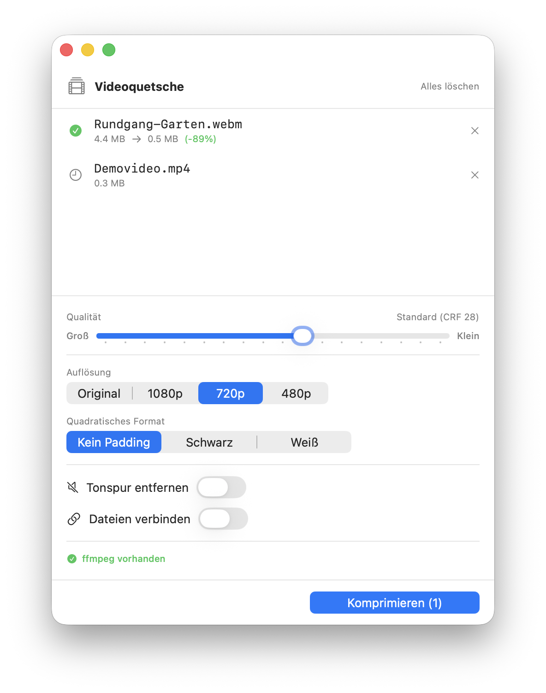

# Videoquetsche

Eine schlanke macOS-App zum Komprimieren von Videos per Drag & Drop — powered by ffmpeg.



## Features

- **Drag & Drop** — Videos einfach ins Fenster oder aufs Dock-Icon ziehen (MP4, MOV, AVI, MKV, WebM, M4V, FLV, WMV, MPG, 3GP)
- **Videos per Link** — Web-Links zu MP4-Videos, HLS-Streams (`.m3u8`) oder m3u-Playlisten einfügen; sie werden per yt-dlp nach `~/Downloads/Videoquetsche` geladen und dann komprimiert
- **Qualität per Slider** — CRF 18–35 (Hohe Qualität bis Sehr klein)
- **Auflösung wählen** — Original, 1080p, 720p oder 480p
- **Quadratisches Format** — Padding mit schwarzem, weißem oder unscharfem Hintergrund (weichgezeichnetes Originalvideo)
- **Dateien verbinden** — mehrere Videos in eine Ausgabedatei zusammenführen
- **Tonspur entfernen** — optional per Toggle
- **Fortschrittsanzeige** — Echtzeit-Progress pro Datei
- **Batch-Verarbeitung** — mehrere Videos nacheinander
- Output-Dateien landen neben dem Original als `*-small.mp4`; die Lupe neben einem fertigen Video zeigt die Datei direkt im Finder

## Voraussetzungen

ffmpeg muss installiert sein, für Links zusätzlich yt-dlp:

```bash
brew install ffmpeg yt-dlp
```

Die App sucht die Tools automatisch unter `/opt/homebrew/bin`, `/usr/local/bin`, `/usr/bin` und `~/.local/bin` und zeigt den Status direkt in der UI an.

## Build

In Xcode öffnen und bauen:

```bash
open VideoCompressor.xcodeproj
```

Oder per Skript (signiert mit Developer ID):

```bash
./build.sh
```

### Release (notarisiert)

Einmalig die Zugangsdaten für die Notarisierung im Schlüsselbund ablegen (App-spezifisches Passwort von appleid.apple.com):

```bash
xcrun notarytool store-credentials "videoquetsche-notary" --apple-id "<apple-id>" --team-id "9H7F5NMT97" --password "<app-spezifisches-passwort>"
```

Dann:

```bash
./build.sh --release
```

baut ein Universal-Binary, signiert, notarisiert, staplet und erzeugt `Videoquetsche.zip`. Mit `./build.sh --publish` wird zusätzlich das GitHub-Release `v<Version>` mit `RELEASE_NOTES.md` angelegt.

## Lizenz

MIT
